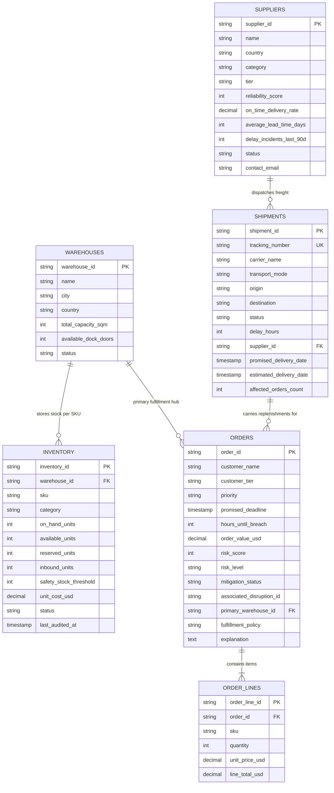

# DisruptionIQ — Synthetic Supply Chain Dataset & Simulation Guide

This directory contains the reproducible synthetic dataset for **DisruptionIQ**, an AI-powered supply chain disruption intelligence and recovery platform. 

The dataset is deterministic, fictional, and engineered with multi-tier operational constraints to test real optimization and recovery engines—including inter-hub transfers, alternate supplier expediting, and inventory rationing.

---

## 1. Simulation Reference Clock

- **Baseline Clock ($T_0$):** `2026-10-26T18:00:00Z` (Monday, October 26, 2026 at 18:00:00 UTC)
- **Time Horizon:** Trailing audits occur between $T_0 - 28\text{h}$ and $T_0$, with customer delivery deadlines extending up to $T_0 + 88\text{h}$.
- **Consistency Rule:** All relative countdown counters (`hours_until_breach` on customer orders and `delay_hours` on shipments) are measured strictly against this simulation timestamp:
  $$\text{hours\_until\_breach} = \max\left(0, \left\lfloor\frac{\text{promised\_deadline} - T_0}{3600}\right\rfloor\right)$$

---

## 2. Entity Relationship Model



---

## 3. Dataset Specifications & Column Definitions

### 3.1 Warehouses (`warehouses.csv` — 3 Facilities)
Distribution and fulfillment hubs located across Europe and North America.

| Column | Type | Constraints | Description |
|---|---|---|---|
| `warehouse_id` | `VARCHAR(16)` | PK | Unique hub code (`WH-RTM-01`, `WH-FRA-01`, `WH-ORD-01`) |
| `name` | `VARCHAR(128)` | Not Null | Operational facility name |
| `location` | `VARCHAR(128)` | Not Null | Logistics park / industrial zone |
| `city` | `VARCHAR(64)` | Not Null | City name |
| `country` | `VARCHAR(64)` | Not Null | Country name |
| `total_capacity_sqm` | `INTEGER` | $> 0$ | Usable storage floor space in square meters |
| `available_dock_doors` | `INTEGER` | $\ge 0$ | Active inbound/outbound loading bays |
| `status` | `VARCHAR(32)` | `active` \| `maintenance` | Operational availability |

### 3.2 Suppliers (`suppliers.csv` — 4 Vendors)
Tier-1 and Tier-2 manufacturers providing compute, optics, power, and microcontrollers.

| Column | Type | Constraints | Description |
|---|---|---|---|
| `supplier_id` | `VARCHAR(16)` | PK | Unique vendor code (`SUP-APX-01` to `SUP-VEX-04`) |
| `name` | `VARCHAR(128)` | Not Null | Fictional vendor corporate name |
| `country` | `VARCHAR(64)` | Not Null | Manufacturing origin country |
| `category` | `VARCHAR(64)` | Not Null | Component specialty domain |
| `tier` | `VARCHAR(16)` | `Tier 1` \| `Tier 2` | Criticality classification |
| `reliability_score` | `INTEGER` | $0 \le x \le 100$ | Vendor scoring index based on 90-day tracking |
| `on_time_delivery_rate` | `DECIMAL(5,2)` | $0.00 \le x \le 100.00$ | Historic percentage of on-time deliveries |
| `average_lead_time_days` | `INTEGER` | $> 0$ | Standard manufacturing + dispatch cycle in days |
| `delay_incidents_last_90d` | `INTEGER` | $\ge 0$ | Number of logged delay incidents in trailing quarter |
| `status` | `VARCHAR(32)` | `preferred` \| `conditional` \| `restricted` | Procurement qualification state |
| `contact_email` | `VARCHAR(128)` | Valid email format | Escalation contact desk |

### 3.3 Inventory (`inventory.csv` — 24 Records: 3 Hubs $\times$ 8 SKUs)
Real-time physical and allocated stock positions.

| Column | Type | Constraints | Description |
|---|---|---|---|
| `inventory_id` | `VARCHAR(16)` | PK | Unique inventory record identifier (`INV-001` to `INV-024`) |
| `warehouse_id` | `VARCHAR(16)` | FK $\to$ `warehouses` | Storage facility identifier |
| `warehouse_name` | `VARCHAR(128)` | Not Null | Name of warehouse for de-normalized reporting |
| `sku` | `VARCHAR(32)` | Not Null | Part number (e.g. `NVX-9400`, `ETH-200X`) |
| `sku_description` | `VARCHAR(128)` | Not Null | Canonical hardware description |
| `category` | `VARCHAR(64)` | Not Null | Hardware family |
| `on_hand_units` | `INTEGER` | $\ge 0$ | Total physical units stored inside the hub |
| `available_units` | `INTEGER` | $\ge 0$ | Unreserved units free for immediate picking/allocation |
| `reserved_units` | `INTEGER` | $0 \le \text{reserved} \le \text{on\_hand}$ | Units committed to pending customer purchase orders |
| `inbound_units` | `INTEGER` | $\ge 0$ | Units currently in transit on active purchase orders |
| `safety_stock_threshold` | `INTEGER` | $\ge 0$ | Minimum buffer threshold; triggers alert status when breached |
| `unit_cost_usd` | `DECIMAL(10,2)` | $> 0$ | Standard cost of goods per unit in USD |
| `status` | `VARCHAR(32)` | `healthy` \| `constrained` \| `critical` | Inventory health status based on available vs threshold |
| `last_audited_at` | `TIMESTAMP` | ISO 8601 | Timestamp of physical inventory cycle count |

**Core Invariants Enforced:**
1. $\text{on\_hand\_units} = \text{available\_units} + \text{reserved\_units}$
2. $\text{reserved\_units} \le \text{on\_hand\_units}$
3. $\text{available\_units} \ge 0$

### 3.4 Shipments (`shipments.csv` — 12 Shipments)
Transit telemetry, modes, carrier details, and delay tracking.

| Column | Type | Constraints | Description |
|---|---|---|---|
| `shipment_id` | `VARCHAR(16)` | PK | Unique shipment ID (`SHP-99214` to `SHP-99225`) |
| `tracking_number` | `VARCHAR(64)` | Unique | Bill of lading or carrier waybill identifier |
| `carrier_name` | `VARCHAR(64)` | Not Null | Freight logistics carrier |
| `transport_mode` | `VARCHAR(16)` | `Ocean` \| `Air` \| `Road` \| `Rail` | Mode of conveyance |
| `origin` | `VARCHAR(64)` | Not Null | Origin port, facility, or air cargo terminal |
| `destination` | `VARCHAR(64)` | Not Null | Destination hub facility or gateway |
| `status` | `VARCHAR(32)` | `on_schedule` \| `delayed` \| `customs_hold` \| `delivered` | Current logistics operational state |
| `delay_hours` | `INTEGER` | $\ge 0$ | Total hours delayed against promised delivery date |
| `supplier_id` | `VARCHAR(16)` | FK $\to$ `suppliers` | Dispatching vendor ID |
| `supplier_name` | `VARCHAR(128)` | Not Null | Vendor name for display transparency |
| `cargo_description` | `VARCHAR(128)` | Not Null | Manifest summary with unit counts and SKUs |
| `promised_delivery_date` | `TIMESTAMP` | ISO 8601 | Contractual SLA arrival target |
| `estimated_delivery_date` | `TIMESTAMP` | ISO 8601 | Revised arrival date computed from carrier telemetry |
| `affected_orders_count` | `INTEGER` | $\ge 0$ | Total open customer orders dependent on this shipment |

### 3.5 Customer Orders (`orders.csv` — 20 Orders)
Downstream customer sales orders with SLA contractual targets and risk scores.

| Column | Type | Constraints | Description |
|---|---|---|---|
| `order_id` | `VARCHAR(16)` | PK | Unique order code (`ORD-8401` to `ORD-8420`) |
| `customer_name` | `VARCHAR(128)` | Not Null | Fictional B2B customer entity |
| `customer_tier` | `VARCHAR(32)` | `Enterprise` \| `Strategic` \| `Standard` | SLA service tier |
| `priority` | `VARCHAR(4)` | `P1` \| `P2` \| `P3` | Operational prioritization code |
| `promised_deadline` | `TIMESTAMP` | ISO 8601 | Contractual cutoff time |
| `hours_until_breach` | `INTEGER` | $\ge 0$ | Remaining time window relative to simulation clock |
| `order_value_usd` | `DECIMAL(12,2)` | $> 0$ | Total commercial revenue (equals sum of order lines) |
| `risk_score` | `INTEGER` | $1 \le x \le 100$ | Calculated risk index based on priority, value, and delay |
| `risk_level` | `VARCHAR(16)` | `critical` \| `high` \| `medium` \| `low` | Risk classification |
| `mitigation_status` | `VARCHAR(32)` | `unmitigated` \| `protected` | Recovery plan status |
| `associated_disruption_id` | `VARCHAR(32)` | Nullable | Disruption reference (`DIS-2026-0891`, `DIS-2026-0894`, or empty) |
| `primary_warehouse_id` | `VARCHAR(16)` | FK $\to$ `warehouses` | Default dispatch hub assigned to fulfill this order |
| `fulfillment_policy` | `VARCHAR(32)` | `FULL_ONLY` \| `PARTIAL_ALLOWED` | Strict complete delivery vs flexible split deliveries |
| `explanation` | `TEXT` | Not Null | Operational context, SLA stakes, and engineering impact |

### 3.6 Order Lines (`order_lines.csv` — 40 Order Lines)
Itemized SKU breakdown for each purchase order.

| Column | Type | Constraints | Description |
|---|---|---|---|
| `order_line_id` | `VARCHAR(32)` | PK | Unique line item ID (e.g. `LINE-8401-01`) |
| `order_id` | `VARCHAR(16)` | FK $\to$ `orders` | Parent customer order reference |
| `sku` | `VARCHAR(32)` | FK $\to$ `inventory.sku` | Ordered hardware SKU code |
| `sku_description` | `VARCHAR(128)` | Not Null | Hardware part description |
| `quantity` | `INTEGER` | $> 0$ | Ordered unit count |
| `unit_price_usd` | `DECIMAL(10,2)` | $> 0$ | Contract sales price per unit |
| `line_total_usd` | `DECIMAL(12,2)` | $> 0$ | $\text{quantity} \times \text{unit\_price\_usd}$ |

---

## 4. Disruption Scenarios & Recovery Engine Test Design

The synthetic dataset is calibrated to test automated recovery planning algorithms across two distinct disruption archetypes:

### Scenario 1: Critical 48-Hour Maritime Berth Delay (`DIS-2026-0891`)
- **Root Cause:** Container vessel *Maersk Antwerpen* suffered auxiliary pump failure at sea followed by forfeiture of its pilotage window at Port of Rotterdam Maasvlakte Terminal.
- **Impacted Inbound Freight:** 
  - `SHP-99214`: Carrying 800 units of `NVX-9400` Server Accelerator Boards (Supplier: `SUP-KYT-02`). Promised: `2026-10-26T06:00:00Z` $\to$ Revised: `2026-10-28T06:00:00Z` (+48 hours).
  - `SHP-99215`: Carrying 600 units of `ETH-200X` Dual-Port 100GbE NICs (Supplier: `SUP-APX-01`). Promised: `2026-10-26T08:00:00Z` $\to$ Revised: `2026-10-28T08:00:00Z` (+48 hours).
- **Warehouse Bottleneck:** Rotterdam Central Hub (`WH-RTM-01`) has only 70 available `NVX-9400` units and 120 available `ETH-200X` units, but face immediate demand from 8 enterprise customer orders (`ORD-8401` through `ORD-8408`).
- **Recovery Engine Solutions:**
  - **Inter-Hub Cross-Dock Transfer:** Frankfurt Air Cargo Center (`WH-FRA-01`) holds 410 available `NVX-9400` units and 380 available `ETH-200X` units in healthy reserve. A dedicated expedited road shuttle (8-hour transit time) can deliver buffer stock from Frankfurt to Rotterdam, shielding high-value P1 orders (`ORD-8401`, `ORD-8402`, `ORD-8406`).
  - **Inventory Rationing Challenge:** Combined network available stock ($70 + 410 = 480$ units) cannot satisfy the total demand across all 8 orders (600 units). The recovery algorithm must prioritize P1/Enterprise orders with `FULL_ONLY` policies and negotiate partial split shipments (`PARTIAL_ALLOWED`) for P2/P3 orders (`ORD-8403`, `ORD-8405`, `ORD-8408`).

### Scenario 2: Tier-1 Supplier Batch Hold / Shortage (`DIS-2026-0894`)
- **Root Cause:** Oven temperature deviation during thermal cycle qualification at Kaohsiung Fab 4 (`SUP-APX-01`) placed lot `LOT-2026-KHS-994` on quality quarantine, postponing ocean shipment `SHP-99220` by 72 hours.
- **Warehouse Bottleneck:** Chicago Central Depot (`WH-ORD-01`) holds only 50 available units of `MCU-8800` automotive microcontrollers against 350 reserved units, with 6 US automotive and defense customer orders facing impending SLA penalties (`ORD-8409` through `ORD-8414`).
- **Recovery Engine Solutions:**
  - **Plausible Alternative Supplier Expedite:** `SUP-VEX-04` (Vextron Semiconductor Ltd in South Korea) is a qualified Tier-2 vendor with compatible microcontroller units. An emergency air charter can deliver 400 replacement units within 48 hours.
  - **Policy-Aware Allocations:** Orders specifying `PARTIAL_ALLOWED` (`ORD-8411`, `ORD-8412`, `ORD-8414`) can receive immediate shipment of their non-MCU lines (such as optical transceivers, fiber looms, or memory), preventing a total customer shutdown.

### Unaffected Baseline Orders for Comparison (`ORD-8415` to `ORD-8420`)
- Orders routed through `WH-FRA-01` or ordering unaffected hardware SKUs (`OPT-5000`, `CAB-HD12`, `PWR-4500`, `FAN-9000`) maintain $100\%$ on-time fulfillment with low risk scores ($10 \text{--} 20$), providing a clean control group for recovery engine performance benchmarking.

---

## 5. Dataset Validation & Integrity Testing

The repository provides an automated verification script that executes 8 independent validation passes:

```bash
# Run validation directly
python datasets/validate_datasets.py
```

Validation checks include:
1. **Schema Check:** Verifies header structure and column ordering across all 6 files.
2. **Cardinality Verification:** Confirms 3 warehouses, 4 suppliers, 24 inventory items, 12 shipments, 20 orders, and $\ge 30$ order lines.
3. **Primary Key Uniqueness:** Asserts zero duplicate IDs across all entities and shipment tracking numbers.
4. **Foreign Key Integrity:** Ensures zero dangling relationships between orders, lines, inventory, warehouses, and suppliers.
5. **Inventory Conservation:** Asserts $\text{on\_hand} = \text{available} + \text{reserved}$ and $\text{reserved} \le \text{on\_hand}$ for all warehouse-SKU pairs.
6. **Order Pricing Arithmetic:** Asserts $\text{line\_total} = \text{quantity} \times \text{unit\_price}$ and $\text{order\_value} = \sum \text{line\_totals}$.
7. **Fulfillment Integrity:** Asserts that open/disrupted simulation orders are never falsely marked as `fulfilled`.
8. **ISO 8601 & Simulation Clock Offsets:** Asserts that `hours_until_breach` corresponds mathematically to the simulation baseline timestamp.

You can also run the full test suite with pytest:
```bash
python -m pytest backend/tests/test_dataset_validation.py
```

---

## 6. How to Load Datasets into SQLite via SQLAlchemy

### Method A: Automated CLI Seeder Script
A production-ready database seeder is included in the backend:

```bash
# From project root
python backend/app/scripts/seed_database.py

# Or as a module from backend directory
cd backend
python -m app.scripts.seed_database
```

Output:
```
Loading synthetic datasets from: .../datasets
Database Target: sqlite:///./data/disruptioniq.db

[OK] Successfully loaded into SQLite database:
  - warehouses  :  3 records
  - suppliers   :  4 records
  - inventory   : 24 records
  - shipments   : 12 records
  - orders      : 20 records
  - order_lines : 40 records
```

### Method B: Programmatic Python / SQLAlchemy Loading
To load or seed the database inside your own tests or recovery engines, use the following pattern:

```python
import csv
from datetime import datetime
from decimal import Decimal
from pathlib import Path

from app.core.database import Base, SessionLocal, engine
from app.models.supply_chain import Warehouse, Supplier, Inventory, Shipment, Order, OrderLine

# 1. Initialize schema
Base.metadata.create_all(bind=engine)

# 2. Open a session
db = SessionLocal()

try:
    # 3. Load Warehouses
    with open("datasets/warehouses.csv", mode="r", encoding="utf-8") as f:
        for row in csv.DictReader(f):
            db.merge(Warehouse(
                id=row["warehouse_id"],
                name=row["name"],
                location=row["location"],
                city=row["city"],
                country=row["country"],
                total_capacity_sqm=int(row["total_capacity_sqm"]),
                available_dock_doors=int(row["available_dock_doors"]),
                status=row["status"],
            ))

    # 4. Load Inventory
    with open("datasets/inventory.csv", mode="r", encoding="utf-8") as f:
        for row in csv.DictReader(f):
            db.merge(Inventory(
                id=row["inventory_id"],
                warehouse_id=row["warehouse_id"],
                warehouse_name=row["warehouse_name"],
                sku=row["sku"],
                sku_description=row["sku_description"],
                category=row["category"],
                on_hand_units=int(row["on_hand_units"]),
                available_units=int(row["available_units"]),
                reserved_units=int(row["reserved_units"]),
                inbound_units=int(row["inbound_units"]),
                safety_stock_threshold=int(row["safety_stock_threshold"]),
                unit_cost_usd=Decimal(row["unit_cost_usd"]),
                status=row["status"],
                last_audited_at=datetime.fromisoformat(row["last_audited_at"].replace("Z", "+00:00")),
            ))

    # 5. Commit transactionally
    db.commit()
    print("Database seeded successfully.")

except Exception:
    db.rollback()
    raise
finally:
    db.close()
```

---

## 7. Deterministic Dataset Regeneration

To regenerate the CSV files from scratch with identical stable IDs and numbers:

```bash
python datasets/generate_datasets.py
```
*(Fixed Random Seed: `42`)*
