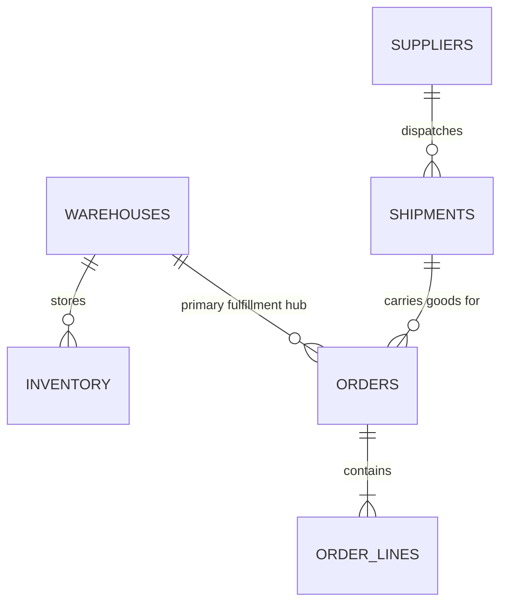

# DisruptionIQ — Synthetic Datasets & Domain Data Dictionary

This document describes the schema, field types, relationships, and business semantics of the synthetic datasets located in the `/datasets` directory.

---

## 1. Entity Relationship Overview

---

## 2. Table Specifications

### 2.1 Warehouses (`datasets/warehouses.csv`)
Distribution hubs and regional cross-dock fulfillment centers.

| Field Name | Type | Key | Description |
|---|---|---|---|
| `warehouse_id` | `VARCHAR(16)` | PK | Unique identifier (e.g., `WH-RTM-01`) |
| `name` | `VARCHAR(128)` | | Full warehouse facility name |
| `location` | `VARCHAR(128)` | | Physical campus / logistics park name |
| `city` | `VARCHAR(64)` | | City location |
| `country` | `VARCHAR(64)` | | Country location |
| `total_capacity_sqm` | `INTEGER` | | Total storage footprint in square meters |
| `available_dock_doors`| `INTEGER` | | Active inbound/outbound loading docks |
| `status` | `VARCHAR(32)` | | Operational status (`active`, `maintenance`) |

---

### 2.2 Suppliers (`datasets/suppliers.csv`)
Component and sub-assembly suppliers across global tiers.

| Field Name | Type | Key | Description |
|---|---|---|---|
| `supplier_id` | `VARCHAR(16)` | PK | Unique identifier (e.g., `SUP-TW-084`) |
| `name` | `VARCHAR(128)` | | Legal vendor corporate entity name |
| `country` | `VARCHAR(64)` | | Manufacturing origin country |
| `category` | `VARCHAR(64)` | | Component domain (e.g. `Microcontrollers & ASICs`) |
| `tier` | `VARCHAR(16)` | | Supply chain criticality (`Tier 1`, `Tier 2`) |
| `reliability_score` | `INTEGER` | | Composite vendor reliability metric (0-100) |
| `on_time_delivery_rate` | `DECIMAL(5,2)` | | 90-day on-time delivery percentage (e.g., 81.40) |
| `average_lead_time_days`| `INTEGER` | | Standard lead time in calendar days |
| `delay_incidents_last_90d` | `INTEGER` | | Disruption events logged in trailing quarter |
| `status` | `VARCHAR(32)` | | Preferred status (`preferred`, `conditional`, `restricted`) |
| `contact_email` | `VARCHAR(128)` | | Escalation contact email |

---

### 2.3 Inventory (`datasets/inventory.csv`)
Stock levels, safety margins, and reserved units per SKU and warehouse.

| Field Name | Type | Key | Description |
|---|---|---|---|
| `inventory_id` | `VARCHAR(16)` | PK | Unique inventory record identifier |
| `warehouse_id` | `VARCHAR(16)` | FK | References `warehouses.warehouse_id` |
| `warehouse_name` | `VARCHAR(128)` | | Name of warehouse |
| `sku` | `VARCHAR(32)` | | Stock Keeping Unit code (e.g., `NVX-9400`) |
| `sku_description` | `VARCHAR(128)` | | Human-readable part description |
| `category` | `VARCHAR(64)` | | Product family grouping |
| `on_hand_units` | `INTEGER` | | Total physical stock physically present in warehouse |
| `available_units` | `INTEGER` | | Unreserved stock ready for allocation |
| `reserved_units` | `INTEGER` | | Stock committed to scheduled orders |
| `inbound_units` | `INTEGER` | | Stock in transit on active shipments |
| `safety_stock_threshold` | `INTEGER` | | Threshold below which stock status becomes critical |
| `unit_cost_usd` | `DECIMAL(10,2)` | | Standard carrying cost per unit in USD |
| `status` | `VARCHAR(32)` | | Health status (`healthy`, `constrained`, `critical`) |
| `last_audited_at` | `TIMESTAMP` | | ISO 8601 timestamp of last cycle count |

---

### 2.4 Shipments (`datasets/shipments.csv`)
Transit tracking, carrier details, and delay telemetry.

| Field Name | Type | Key | Description |
|---|---|---|---|
| `shipment_id` | `VARCHAR(16)` | PK | Unique shipment ID (e.g., `SHP-99214`) |
| `tracking_number` | `VARCHAR(64)` | | Carrier master bill of lading / waybill |
| `carrier_name` | `VARCHAR(64)` | | Logistics service provider |
| `transport_mode` | `VARCHAR(16)` | | `Ocean`, `Air`, `Road`, `Rail` |
| `origin` | `VARCHAR(64)` | | Origin port or terminal |
| `destination` | `VARCHAR(64)` | | Destination hub or port |
| `status` | `VARCHAR(32)` | | `on_schedule`, `delayed`, `customs_hold`, `delivered` |
| `delay_hours` | `INTEGER` | | Total hours delayed against planned ETA |
| `supplier_id` | `VARCHAR(16)` | FK | References `suppliers.supplier_id` |
| `supplier_name` | `VARCHAR(128)` | | Vendor name |
| `cargo_description` | `VARCHAR(128)` | | Manifest summary |
| `promised_delivery_date` | `TIMESTAMP` | | Contractual delivery window |
| `estimated_delivery_date` | `TIMESTAMP` | | Real-time ETA computed from telemetry |
| `affected_orders_count` | `INTEGER` | | Orders blocked by this shipment delay |

---

### 2.5 Orders (`datasets/orders.csv`)
Customer purchase orders linked to SLAs and disruption exposure.

| Field Name | Type | Key | Description |
|---|---|---|---|
| `order_id` | `VARCHAR(16)` | PK | Unique order ID (e.g., `ORD-8491`) |
| `customer_name` | `VARCHAR(128)` | | Customer corporate entity |
| `customer_tier` | `VARCHAR(32)` | | Service level tier: `Enterprise`, `Strategic`, `Standard` |
| `priority` | `VARCHAR(4)` | | Escalation priority: `P1`, `P2`, `P3` |
| `promised_deadline` | `TIMESTAMP` | | SLA contract fulfillment cutoff |
| `hours_until_breach`| `INTEGER` | | Countdown to SLA non-performance |
| `order_value_usd` | `DECIMAL(12,2)` | | Total commercial gross order value |
| `risk_score` | `INTEGER` | | Computed risk index (1 to 100) |
| `risk_level` | `VARCHAR(16)` | | Risk classification: `critical`, `high`, `medium`, `low` |
| `mitigation_status` | `VARCHAR(32)` | | `unmitigated`, `candidate_plan`, `approved`, `protected` |
| `associated_disruption_id` | `VARCHAR(32)` | | Root cause disruption ID |
| `primary_warehouse_id` | `VARCHAR(16)` | FK | Assigned dispatch hub (`warehouses.warehouse_id`) |
| `fulfillment_policy` | `VARCHAR(32)` | | Fulfillment constraint: `FULL_ONLY` or `PARTIAL_ALLOWED` |
| `explanation` | `TEXT` | | Risk reasoning and SLA impact summary |

---

### 2.6 Order Lines (`datasets/order_lines.csv`)
SKU breakdown and itemized unit pricing for each purchase order.

| Field Name | Type | Key | Description |
|---|---|---|---|
| `order_line_id` | `VARCHAR(32)` | PK | Unique line item ID |
| `order_id` | `VARCHAR(16)` | FK | References `orders.order_id` |
| `sku` | `VARCHAR(32)` | | Product SKU code |
| `sku_description`| `VARCHAR(128)` | | SKU part name |
| `quantity` | `INTEGER` | | Units demanded |
| `unit_price_usd` | `DECIMAL(10,2)` | | Contract price per unit |
| `line_total_usd` | `DECIMAL(12,2)` | | Line item revenue |
